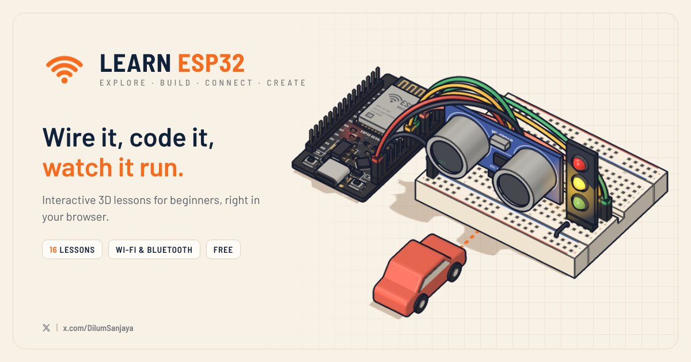

# ESP32 LAB

> **Build Beyond Boundaries.**  
> *Interactive Electronics & Simulation Lab*

**ESP32 LAB** is an interactive 3D electronics, embedded systems, and robotics learning platform built for students, makers, electronics enthusiasts, and developers.



---

## ✨ Features

- **Interactive 3D ESP32 Board**: Fully rendered Three.js / WebGL 3D microcontroller board with interactive pins, live camera controls (pan, rotate, zoom), and component inspector.
- **20 Interactive Lessons**: From beginner GPIO and Wi-Fi to Bluetooth, distance meters, servos, OLEDs, and ESP-NOW communication.
- **Live Circuit Schematics**: Dynamic schematic viewer for each lesson with component pinout details.
- **In-Browser Code Runner & Serial Monitor**: Test sketches, watch pin states, and view simulated serial output directly in the browser.
- **Multi-Device Responsive Experience**: Tailored layouts for wide desktop screens, tablets, and compact mobile displays.
- **Device-Specific Icons & PWA**: Optimized favicons, multi-resolution `.ico`, Apple touch icon (`180x180`), Android icons (`192x192`, `512x512`, and maskable).
- **GSAP 3.12 Animations**: High-performance, gentle on-load and after-load staggered choreographies, progress bar glow sweeps, and micro-interactions.
- **Multilingual Support**: Internationalization across 20+ languages.

---

## 🚀 Running Locally

No heavy toolchains or package installations required. You can serve the project using Python or any static web server:

### Using Python:
```bash
python server.py
```
Open your browser and navigate to:
```
http://localhost:8000
```

### Using Node.js:
```bash
npx serve .
```

---

## 📁 Project Structure

```
├── assets/
│   ├── animations.js          # GSAP 3.12 entrance & micro-interactions
│   ├── gsap.min.js            # GreenSock Animation Platform library
│   ├── brand-chip.svg         # Microchip brand mark vector
│   ├── chip-icon.png          # High-resolution chip icon
│   ├── logo-horizontal*.png   # Horizontal brand logos (dark/light)
│   ├── index-*.js             # Core application bundle
│   ├── index-*.css            # Theme & layout styling
│   ├── stage-*.js             # Three.js 3D board scene & WebGL canvas
│   └── kit-*.js               # Lesson electronics simulation components
├── index.html                 # Main application document & SEO metadata
├── server.py                  # Lightweight local development server
├── site.webmanifest           # Progressive Web App manifest
├── favicon.ico                # Desktop multi-resolution icon (16/32/48)
├── favicon.svg                # Scalable vector favicon
├── apple-touch-icon.png       # iOS Apple touch icon (180x180)
├── icon-192.png               # Android standard launcher icon (192x192)
├── icon-512.png               # Android splash icon (512x512)
└── icon-maskable-512.png      # Android adaptive safe-zone maskable icon
```

---

## 🎨 Credits & Branding

- **Design & Curation**: Azenn
- **Platform**: ESP32 LAB
